# 🔍 Báo Cáo Phân Tích Kỹ Thuật: Bằng Chứng Can Thiệp Steam & Phân Phối Bản Quyền Trái Phép của NestG Launcher

> **Tài liệu Điều tra Kỹ thuật Phần mềm (Software Technical Investigation Report)**  
> **Đối tượng phân tích:** Ứng dụng Desktop *NestG Launcher* (Mã nguồn C# .NET 8 sau khi giải mã hoàn toàn từ Single-File Bundle gốc).  
> **Mục đích:** Phân tích quy trình vận hành (workflow) và tổng hợp bằng chứng kỹ thuật từ mã nguồn chứng minh phần mềm thực hiện hành vi can thiệp trái phép vào phần mềm Steam client, vượt qua cơ chế bảo vệ bản quyền (DRM Bypass), và cài đặt các tệp tin crack/lậu vào máy tính người dùng dưới danh nghĩa dịch vụ thương mại.

---

## 📑 Mục Lục
1. [Tóm tắt Kết quả Điều tra (Executive Summary)](#1-tóm-tắt-kết-quả-điều-tra-executive-summary)
2. [Sơ đồ Luồng Vận hành Tổng thể (Operational Workflow)](#2-sơ-đồ-luồng-vận-hành-tổng-thể-operational-workflow)
3. [Dẫn chứng Kỹ thuật từ Mã Nguồn (Source Code Evidence)](#3-dẫn-chứng-kỹ-thuật-từ-mã-nguồn-source-code-evidence)
   - [3.1. Tấn công DLL Hijacking & Chèn mã độc hại vào Steam (`Patcher.cs`)](#31-tấn-công-dll-hijacking--chèn-mã-độc-hại-vào-steam-patchercs)
   - [3.2. Tự động can thiệp vô hiệu hóa Windows Defender (`DefenderApply.ps1`)](#32-tự-động-can-thiệp-vô-hiệu-hóa-windows-defender-defenderapplyps1)
   - [3.3. Phân phối và ghi đè file crack "Online-Fix" & "Pypass" (`OnlineFixInstallService.cs`)](#33-phân-phối-và-ghi-đè-file-crack-online-fix--pypass-onlinefixinstallservicecs)
   - [3.4. Hệ thống "Token Farm" chia sẻ lậu bản quyền Denuvo qua SignalR](#34-hệ-thống-token-farm-chia-sẻ-lậu-bản-quyền-denuvo-qua-signalr)
   - [3.5. Nhúng các công cụ bẻ khóa Steam của bên thứ ba (`BetterSteamTools`, `OpenSteamTool`)](#35-nhúng-các-công-cụ-bẻ-khóa-steam-của-bên-thứ-ba-bettersteamtools-opensteamtool)
4. [Bảng Đối chiếu Hành vi Vi phạm Quy định & Pháp luật](#4-bảng-đối-chiếu-hành-vi-vi-phạm-quy-định--pháp-luật)
5. [Kết luận Kỹ thuật (Technical Conclusion)](#5-kết-luận-kỹ-thuật-technical-conclusion)

---

## 1. Tóm tắt Kết quả Điều tra (Executive Summary)

Qua quá trình đảo ngược mã nguồn (Reverse Engineering) toàn bộ mã nhị phân của **NestG Launcher**, chúng tôi phát hiện phần mềm này tuy được quảng bá như một *"nền tảng phân phối game bản quyền giá rẻ"*, nhưng về mặt kỹ thuật, hệ sinh thái này hoạt động hoàn toàn dựa trên:
1. **Can thiệp trái phép tiến trình Steam Client**: Sử dụng kỹ thuật **DLL Hijacking** (`dwmapi.dll`, `xinput1_4.dll`) và kỹ thuật **Code Cave Injection** để chặn bắt các gói tin mạng Steam (`CloudOnSendPkt`), vô hiệu hóa các bước kiểm tra tính toàn vẹn của ứng dụng Steam.
2. **Tắt cơ chế bảo mật hệ điều hành**: Tự động cấp quyền UAC để chạy script PowerShell thêm thư mục game và thư mục Steam vào danh sách ngoại lệ của **Windows Defender** (`Add-MpPreference`), nhằm ngăn Windows chặn các tập tin bẻ khóa độc hại.
3. **Phân phối tập trung các bản crack lậu**: Máy chủ `nestg.cloud` tải trực tiếp các tệp tin crack từ cộng đồng bẻ khóa (Online-Fix, Pypass), sau đó tự động giải nén và **ghi đè lên thư mục game Steam gốc** của khách hàng.
4. **Khai thác lậu hệ thống Denuvo Offline Ticket**: Sử dụng kiến trúc Client - Server thời gian thực (SignalR Hub) để phân phối vé kích hoạt Denuvo (Denuvo ticket) từ các tài khoản quản trị viên cho hàng trăm khách hàng cùng lúc, vi phạm nghiêm trọng bản quyền của các nhà phát hành game (EA, Ubisoft, Sega, Capcom, v.v.).

---

## 2. Sơ đồ Luồng Vận hành Tổng thể (Operational Workflow)

Quy trình tự động cài đặt game lậu của NestG Launcher diễn ra theo luồng khép kín dưới đây:

```mermaid
sequenceDiagram
    autonumber
    actor User as Khách Hàng
    participant Launcher as NestG Launcher (Client)
    participant PS as PowerShell / Defender Engine
    participant Steam as Steam Client (Valve)
    participant Server as Máy Chủ NestG (nestg.cloud)
    participant ThirdParty as Catbox / External CDN

    User->>Launcher: Chọn tải/chơi game (Game thường / Denuvo / Online)
    
    rect rgb(30, 20, 20)
        Note over Launcher,PS: Giai đoạn 1: Vô hiệu hóa Antivirus
        Launcher->>PS: Thực thi DefenderApply.ps1 (Yêu cầu UAC Admin)
        PS->>PS: Add-MpPreference -ExclusionPath (Bỏ quét thư mục Steam & Game)
    end

    rect rgb(20, 30, 20)
        Note over Launcher,Steam: Giai đoạn 2: Tấn công DLL Hijacking vào Steam
        Launcher->>ThirdParty: Tải DLL payload giả mạo (files.catbox.moe/heom44.dll)
        Launcher->>Steam: Copy dwmapi.dll / xinput1_4.dll vào thư mục Steam
        Launcher->>Steam: Patch byte Steam.exe (Chèn opcode RET: 0xC3, NOP: 0x90)
        Launcher->>Steam: Inject cloud_redirect.dll hook gói tin CloudOnSendPkt
    end

    rect rgb(20, 20, 35)
        Note over Launcher,Server: Giai đoạn 3: Phân phối & Ghi đè Crack
        Launcher->>Server: Gửi yêu cầu gói crack (DownloadLibraryOnlineFixPackageAsync)
        Server-->>Launcher: Trả về file ZIP chứa crack + Mật khẩu giải nén
        Launcher->>Steam: Ghi đè file DLL crack vào thư mục cài đặt game Steam
        Launcher->>Steam: Tạo shortcut giả mạo steam_settings/configs.user.ini
    end

    rect rgb(35, 20, 35)
        Note over Launcher,Server: Giai đoạn 4: Chia sẻ lậu Token Denuvo
        Launcher->>Server: Kết nối SignalR Hub (DesktopDenuvoActiveRealtimeClient)
        Server-->>Launcher: Bắn Denuvo Ticket được cấp từ tài khoản Master
        Launcher->>Steam: Nạp offline ticket vào game -> Game mở mà không mua bản quyền
    end

    Launcher-->>User: Báo "Cài đặt & Kích hoạt thành công!"
```



---

## 3. Dẫn chứng Kỹ thuật từ Mã Nguồn (Source Code Evidence)

Mọi dẫn chứng dưới đây đều được trích xuất trực tiếp từ mã nguồn C# nguyên bản của dự án sau khi dịch ngược.

### 3.1. Tấn công DLL Hijacking & Chèn mã độc hại vào Steam (`Patcher.cs`)
- **Tập tin**: `src/NestG_Launcher/app_desktop.Services.CloudRedirect.Patching/Patcher.cs`
- **Mã nguồn thực tế**:
  ```csharp
  // Dòng 24: Khai báo 2 thư viện chuẩn của Windows để lợi dụng DLL Hijacking
  private static readonly string[] HijackCandidates = new string[2] { "xinput1_4.dll", "dwmapi.dll" };

  // Dòng 30-47: Code Cave nhị phân chèn cloud_redirect.dll và hàm CloudOnSendPkt
  private static readonly byte[] CloudRedirectCaveContent = new byte[144]
  {
      81, 82, 65, 80, 83, 72, 131, 236, 40, ...
      99, 108, 111, 117, 100, 95, 114, 101, 100, 105, 114, 101, 99, 116, 46, 100, 108, 108, 0, // "cloud_redirect.dll"
      67, 108, 111, 117, 100, 79, 110, 83, 101, 110, 100, 80, 107, 116, 0                      // "CloudOnSendPkt"
  };

  // Dòng 63-73: Tải file DLL không rõ nguồn gốc từ dịch vụ chia sẻ file ẩn danh Catbox
  private const string XinputUrl = "https://files.catbox.moe/heom44.dll";
  private const string DwmapiUrl = "https://files.catbox.moe/32p6f9.dll";
  private const string XinputFallbackUrl = "https://update.aaasn.com/update";
  private const string DwmapiFallbackUrl = "https://update.aaasn.com/dwmapi";

  // Dòng 75-79: Trực tiếp can thiệp nhị phân vào Steam.exe bằng Assembly Opcode
  private const int StExePatchOffset = 164592;
  private static readonly byte[] StExeOriginal = new byte[2] { 64, 85 };
  private static readonly byte[] StExePatched = new byte[2] { 195, 144 }; // 195 = 0xC3 (RET), 144 = 0x90 (NOP)
  ```
- **Ý nghĩa kỹ thuật**:
  - `0xC3` (`RET`) kết hợp `0x90` (`NOP`) tại offset `164592` của tệp tin thực thi Steam là hành vi **bẻ khóa phần mềm cổ điển (Binary Cracking)** nhằm ép buộc hàm xác thực của Steam lập tức thoát ra và trả về kết quả hợp lệ giả mạo.
  - Sử dụng link tải `catbox.moe` — một dịch vụ lưu trữ vô danh thường được giới bẻ khóa phần mềm ngầm sử dụng để tránh bị kiểm duyệt bản quyền DMCA.

---

### 3.2. Tự động can thiệp vô hiệu hóa Windows Defender (`DefenderApply.ps1`)
- **Tập tin**: `src/NestG_Launcher/app_desktop.Services.SteamExclusions.DefenderApply.ps1`
- **Mã nguồn thực tế**:
  ```powershell
  # Dòng 20-23: Tự động chạy quyền quản trị để tắt quét mã độc
  if (-not (Test-NestGCovered $path $snapshot.Paths)) {
      # Thêm toàn bộ đường dẫn thư mục cài game và thư mục Steam vào Exclusion
      Defender\Add-MpPreference -ExclusionPath $path -ErrorAction Stop
  }
  ```
- **Ý nghĩa kỹ thuật**:
  - Khi một launcher chính thống cài đặt game (như Steam, Epic Games, GOG), **không bao giờ** yêu cầu quyền Administrator để vô hiệu hóa Windows Defender.
  - NestG Launcher bắt buộc phải làm điều này vì các tập tin DLL chèn vào (`cloud_redirect.dll`, `dwmapi.dll`) mang đặc trưng nhận dạng của trojan/hooking DLL và sẽ bị Windows Defender chặn ngay lập tức nếu không thêm ngoại lệ.

---

### 3.3. Phân phối và ghi đè file crack "Online-Fix" & "Pypass" (`OnlineFixInstallService.cs`)
- **Tập tin**: `src/NestG_Launcher/app_desktop.Services/OnlineFixInstallService.cs`
- **Mã nguồn thực tế**:
  ```csharp
  // Dòng 95-97: Tải file zip crack từ API server và ghi đè vào thư mục game Steam
  DesktopDownloadedFileResponse package = await storefrontApiClient.DownloadLibraryOnlineFixPackageAsync(
      detail.LibraryId, accessToken, text, ResolvePackageFallbackFileName(detail, online), cancellationToken);

  OnlinePackageInstallResult installResult = await Task.Run(() => 
      InstallPackage(package.FullPath, installDirectory, trackingId, package.ZipPassword, messages), cancellationToken);

  // Dòng 107-110: Cấu hình thông số khởi chạy để bỏ qua bước kiểm tra bản quyền Steam
  SteamShortcutName = online.SteamShortcutName,
  LaunchArguments = online.LaunchArguments,
  LaunchMode = online.LaunchMode,
  GameExePath = gameExePath
  ```
- **Ý nghĩa kỹ thuật**:
  - **Online-Fix** là một nhóm bẻ khóa game đa người chơi (multiplayer crack) nổi tiếng trên thế giới chuyên dùng Spacewar (AppID 480) để chơi lậu server Steam.
  - NestG Launcher đã tự động hóa việc kéo các bản crack Online-Fix về máy khách và ghi đè đè lên tệp gốc của game, xóa bỏ hoàn toàn quyền kiểm soát bản quyền của Valve.

---

### 3.4. Hệ thống "Token Farm" chia sẻ lậu bản quyền Denuvo qua SignalR
- **Tập tin**: 
  - `src/NestG_Launcher/app_desktop.Services/DesktopDenuvoActiveRealtimeClient.cs`
  - `src/NestG_Launcher/app_desktop.Services/DenuvoFixInstallService.cs`
- **Mã nguồn thực tế**:
  ```csharp
  // DenuvoFixInstallService.cs - Dòng 32: Dùng file cấu hình chuẩn của các bộ giả lập Steam crack
  public string ConfigRelativePath { get; set; } = "steam_settings/configs.user.ini";

  // DesktopDenuvoActiveRealtimeClient.cs - Dòng 267-293: Luồng đồng bộ trạng thái bẻ khóa Denuvo
  switch (status)
  {
      case "waiting_user_active_game":
      case "waiting_steam_download":
      case "waiting_user_load_key":
          await TrySyncSteamGameStateAsync(item, status, accessToken, cancellationToken);
          break;
      case "token_issued":
      case "token_delivered":
          // Bắn token kích hoạt Denuvo lấy từ tài khoản admin sang cho khách
          await TryApplyTokenAsync(item, accessToken, cancellationToken);
          break;
  }
  ```
- **Ý nghĩa kỹ thuật**:
  - `steam_settings/configs.user.ini` là đường dẫn cấu hình kinh điển của các bộ giả lập Steam Emulator (Goldberg Emulator / CreamAPI).
  - Bản quyền Denuvo gốc chỉ cho phép 5 máy kích hoạt trong vòng 24 giờ. NestG Launcher đã xây dựng một hệ thống phân phối token trung gian (SignalR realtime queue), lấy token từ 1 máy mua bản quyền thật rồi "bắn" sang máy khách hàng, biến một bản game mua lẻ thành bản game kích hoạt lậu cho hàng trăm người.

---

### 3.5. Nhúng các công cụ bẻ khóa Steam của bên thứ ba (`BetterSteamTools`, `OpenSteamTool`)
- **Tài nguyên nhúng**:
  - `src/NestG_Launcher/NestG.RuntimeBundles.bettersteamtools-cloud.json`
  - `src/NestG_Launcher/NestG.RuntimeBundles.opensteamtool-cloud.json`
- **Mã nguồn thực tế**:
  ```json
  {
    "relativePath": "cloud_redirect.dll",
    "installPath": "cloud_redirect.dll"
  },
  {
    "installPath": "cloud_redirect/licenses/OpenSteamTool-LICENSE.txt"
  },
  {
    "installPath": "cloud_redirect/sources/BetterSteamTools-NestG-source.zip"
  }
  ```
- **Ý nghĩa kỹ thuật**:
  - Launcher tích hợp sẵn các gói công cụ **OpenSteamTool** và **BetterSteamTools** — đây là các công cụ mã nguồn mở được phát triển để can thiệp Steam App Manifest, cho phép tải và mở khóa các game/DLC chưa từng được tài khoản Steam của người dùng sở hữu.

---

## 4. Bảng Đối chiếu Hành vi Vi phạm Quy định & Pháp luật

| Hành vi Kỹ thuật của NestG Launcher | Tập tin Liên quan | Vi phạm Điều khoản Dịch vụ Steam (SSA) & Luật Sở hữu Trí tuệ |
| :--- | :--- | :--- |
| **DLL Hijacking & Binary Patching** | `Patcher.cs` | Vi phạm **Mục 2.C & 3.A của Steam Subscriber Agreement (SSA)**: Nghiêm cấm hành vi decompile, modify, reverse engineer hoặc tạo phần mềm can thiệp vào máy khách Steam. |
| **Ghi đè file crack Online-Fix / Pypass** | `OnlineFixInstallService.cs` | Vi phạm **Luật Sở hữu Trí tuệ (Bản quyền phần mềm)**: Phân phối và thương mại hóa các bản sao phần mềm không có sự đồng ý của tác giả/nhà phát hành. |
| **Khai thác lỗ hổng chia sẻ Token Denuvo** | `DesktopDenuvoActiveRealtimeClient.cs` | Vi phạm **Thỏa thuận Giấy phép Người dùng Cuối (EULA)** của Denuvo Software Solutions GmbH và các nhà phát hành game AAA. |
| **Bypass kiểm duyệt Defender** | `DefenderApply.ps1` | Hành vi cố tình hạ thấp phòng thủ của hệ điều hành, tiềm ẩn nguy cơ bảo mật cực lớn đối với thiết bị của người dùng cuối. |
| **Bẻ khóa kho game qua Manifest Hook** | `opensteamtool-cloud.json` | Gian lận bản quyền máy chủ Steam Content Server (CS) của Valve Corporation. |

---

## 5. Kết luận Kỹ thuật (Technical Conclusion)

Dựa trên toàn bộ cấu trúc mã nguồn đã được thẩm định độc lập:
1. **NestG Launcher KHÔNG PHẢI là một nhà phân phối game bản quyền.**
2. Bản chất kỹ thuật của NestG Launcher là một **công cụ bẻ khóa tự động hóa (Automated DRM Bypass & Cracking Suite)** được bọc trong giao diện người dùng WebView2 bóng bẩy.
3. Người dùng trả tiền cho NestG thực chất đang trả tiền cho một dịch vụ **bẻ khóa và chia sẻ game lậu có tổ chức**, đồng thời máy tính của họ bị can thiệp sâu vào các tệp hệ thống, tệp Steam gốc và bị tắt các cơ chế phòng vệ Antivirus quan trọng.

---
*Báo cáo được tổng hợp dựa trên kết quả phân tích nhị phân và mã nguồn C# thực tế.*
